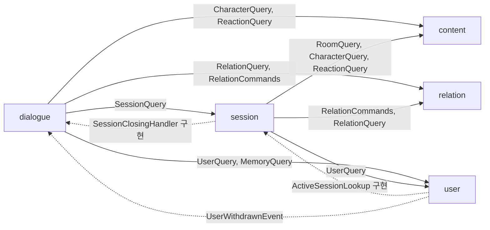
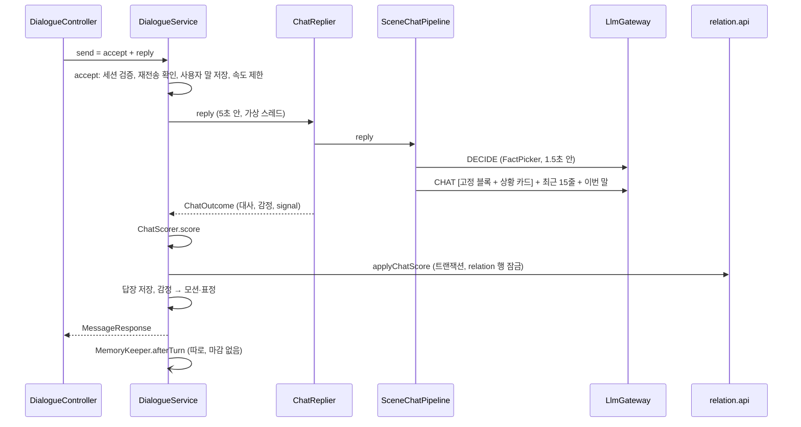
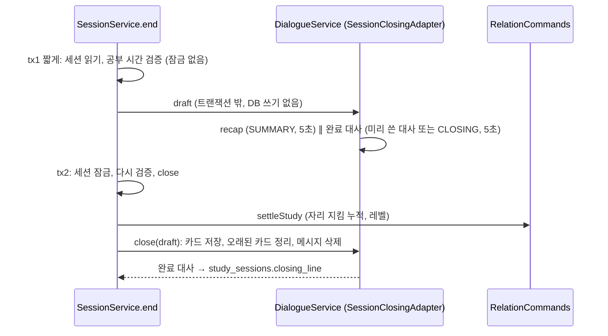

# 캡슐 백엔드 구조

AI 캐릭터와 함께 공부하는 웹서비스의 백엔드를 한 장으로 정리한다. 기준은 develop 코드(2026-11-05, #119까지)다.
설계 이유는 `docs/decisions/`(ADR), API·DB 명세는 `docs/specs/api.md`·`schema.sql`, 하네스는 `docs/HARNESS.md`에 있다.
여기 적힌 클래스·설정 이름은 코드에 실제로 있는 것만 썼다. 코드가 바뀌면 이 문서도 같이 고친다.

---

## 1. 한눈에

Spring Boot 모듈러 모놀리스다. 앱은 하나지만 `com.capsule` 아래 다섯 개 업무 모듈(user, content, session, relation, dialogue)과 공용 `common`으로 나뉜다.
모듈끼리는 상대 모듈의 `api` 패키지(인터페이스 + DTO)만 부른다. 경계는 Spring Modulith가 `ModularityTests`로 검사한다.
의존이 순환할 자리는 인터페이스를 거꾸로 둔다(session이 `SessionClosingHandler`를 두고 dialogue가 구현, user가 `ActiveSessionLookup`을 두고 session이 구현).
이벤트는 지금 하나뿐이다: 회원 탈퇴 `UserWithdrawnEvent`(동기, 같은 트랜잭션). LLM은 dialogue 모듈 안의 `LlmGateway` 하나로만 부른다.

| 항목 | 내용 | 근거 |
|---|---|---|
| 언어·프레임워크 | Java 21, Spring Boot 4.1.2 (webmvc, data-jpa, validation, actuator) | build.gradle |
| 모듈 구조 | Spring Modulith 2.1.1, 모듈 안 레이어 패키지 | ADR 0001, 0012 |
| DB | PostgreSQL + Flyway(타임스탬프 버전, out-of-order), `ddl-auto: validate` | ADR 0002 |
| 캐시·토큰 | Redis (리프레시 토큰, 인증번호, 요청 횟수 제한) | ADR 0009 |
| 인증 | Spring Security + JWT(oauth2 resource server), 리프레시는 Redis | ADR 0011 |
| 테스트 | JUnit + Testcontainers(Postgres·Redis), H2 안 씀 | ADR 0003 |
| 포맷 | Spotless + palantir-java-format | build.gradle |
| API 문서 | springdoc(Swagger), local 프로필에서만 | ADR 0019 |
| 배포 | Railway(Dockerfile) 개발 서버, 운영 DB·에셋은 Supabase, 메일은 Brevo HTTPS | ADR 0016~0020, 0024 |
| LLM | SDK 없이 RestClient·JDK HttpClient로 Anthropic·OpenAI·Jev 호출, 프롬프트는 DB 버전 | ADR 0022 |
| 스트리밍 | Spring MVC `SseEmitter` (명세 28) | ADR 0025 |

### 프로필

| 프로필 | 파일 | 언제 | 핵심 |
|---|---|---|---|
| (공용) | `application.yml` | 항상 | `capsule.*` 기본값 전부. 비밀값은 환경변수로만 |
| local | `application-local.yml` | `scripts/run-local.sh` | Docker 로컬 DB, 예시 시드(`db/seed`), Swagger 켬, 실험실 켬, Fake 카카오·메일, LLM 원문 기록 |
| shared-db | `application-shared-db.yml` | `run-local.sh --shared` (local 위에) | 공용 개발 DB(Supabase 개발 프로젝트). 앱은 Flyway를 끔 → 마이그레이션은 develop 머지 때 Actions만 (ADR 0017) |
| dev-server | `application-dev-server.yml` | Railway, `local,shared-db,dev-server` | 실제 Redis·Brevo·카카오, `CAPSULE_LLM_PROVIDER` 필수, 실험실 끔, 원문 기록 끔 |
| prod | `application-prod.yml` | 운영 | Supabase DB(Session pooler), 시드 없음, 기본값 없이 빠지면 시작 실패 |
| test | `src/test/resources/application-test.yml` | 테스트 | LLM `fake`, `memory-async: false`, 실험실 켬 |

실선은 "상대 api를 부른다", 점선은 "인터페이스는 앞 모듈에 있고 구현은 뒤 모듈"이라는 뜻이다. dialogue는 `api` 패키지가 없다(아무도 dialogue를 직접 부르지 않는다).

---

## 2. 폴더별 구조

### 최상위

| 경로 | 내용 |
|---|---|
| `src/main/java/com/capsule/` | 앱 코드. `CapsuleApplication` + 모듈 6개 |
| `src/main/resources/application*.yml` | 설정 (위 프로필 표) |
| `src/main/resources/db/migration/` | Flyway 마이그레이션 `V<타임스탬프>__<모듈>_<설명>.sql`. `scripts/new-migration.sh`로만 만든다 |
| `src/main/resources/db/seed/` | 예시 데이터 `R__demo_content.sql`, `R__demo_terms.sql` (local·test·공용 개발 DB만, 운영 제외) |
| `src/main/resources/prompts/` | 공통 프롬프트 시드 (`PromptSeeder`가 DB `prompt_versions`에 넣음) |
| `src/main/resources/characters/malfoy/profile.yml` | 말포이 캐릭터 설정 시드 (`CharacterContentSeeder`가 DB에 넣음) |
| `src/main/resources/llm-lab/` | 실험실 화면 `index.html`, 흐름 테스트 `flow.html` |
| `src/test/java/com/capsule/` | 모듈별 테스트, `ModularityTests`, `FlowE2ETest`, `SwaggerTest` |
| `http/` | IntelliJ HTTP 요청 예시: `flow.http`(전체 흐름), `llm-lab.http`, `eval-malfoy.http`(평가 대본) |
| `scripts/` | `verify.sh`, `new-migration.sh`, `run-local.sh`, `setup.sh`, `smoke-flow.sh` |
| `docs/specs/` | 명세 원본 `api.md`, `schema.sql`, `flow.md`, `judgment-backlog.md`(TODO(judgment) 목록), `skeleton-plan.md` |
| `docs/decisions/` | ADR 0001~0025 |
| `.harness/` | `phase`(지금 `domain`), `zones.conf`(구역·담당표), `zones.py` |
| `.claude/` | `skills/`, `agents/reviewer.md`, `hooks/`, `settings.json` |
| `.github/` | PR 템플릿, 이슈 템플릿, `workflows/dev-db-migrate.yml`(공용 개발 DB 마이그레이션) |
| `Dockerfile`, `railway.json`, `docker-compose.yml` | 배포·로컬 DB |

### 모듈 레이아웃 규칙

모든 모듈은 같은 모양이다(ADR 0012, `.claude/skills/skeleton/references/module-layout.md`).
`api`(다른 모듈이 쓰는 유일한 입구) · `adapter`(api 구현) · `controller` · `service` · `dto` · `repository` · `domain`(JPA 엔티티) · `client`(외부 호출) · `config`.

### common (공용, 담당 없음 = shared 구역)

| 패키지 | 클래스 | 하는 일 |
|---|---|---|
| config | `ApiTags`, `OpenApiConfig` | Swagger 묶음 이름과 순서 |
| error | `ApiException`, `ErrorResponse`, `GlobalExceptionHandler` | 명세 에러 코드 그대로 내보내기 `{code, message, detail}` |
| ratelimit | `RateLimiter` | Redis 고정 창 횟수 제한 (INCR + EXPIRE) |
| security | `SecurityConfig`, `AuthProperties`, `LoginUser`, `LoginUserArgumentResolver` | JWT 검증, `@LoginUser long userId` |
| time | `ClockConfig` | 현재 시각은 `Clock`으로만, 날짜는 한국(KST) 기준 |

### user (담당 성욱) — 가입·로그인·내 정보·일정·탈퇴 (api 1~8, 10, 13, 14, 24~27)

| 패키지 | 주요 클래스 |
|---|---|
| api | `UserQuery`(프로필), `MemoryQuery`(대화에 넣을 일정), `ActiveSessionLookup`(session이 구현), `UserWithdrawnEvent`, `UserTypes` |
| controller | `AuthController`(인증·약관·비밀번호), `MeController`(`/api/me`, 일정) |
| service | `AuthService`, `TokenService`(JWT 30분 + Redis 리프레시), `ProfileService`, `MemoryService`(일정), `PasswordResetService`, `WithdrawalService` |
| client | `KakaoClient`(`HttpKakaoClient` / `FakeKakaoClient`), `EmailSender`(`BrevoEmailSender` / `FakeEmailSender`) |
| adapter | `UserQueryAdapter`, `MemoryQueryAdapter` |
| domain | `User`, `UserMemory`(`user_memories`: 사용자가 적은 시험·목표·약속) |

`user_memories`(사용자 일정)와 dialogue의 `character_memories`(캐릭터가 대화에서 알게 된 사실)는 다른 것이다.

### content (담당 성욱) — 룸·캐릭터·아바타·Live2D·반응 매핑 (api 9)

| 패키지 | 주요 클래스 |
|---|---|
| api | `CharacterQuery`, `RoomQuery`, `AvatarQuery`, `ReactionQuery`(trigger·감정 → 모션·표정), `ContentTypes` |
| adapter | `CharacterQueryAdapter`, `RoomQueryAdapter`, `AvatarQueryAdapter`, `ReactionQueryAdapter`, `ContentMapper`(CDN 주소 붙이기) |
| controller | `AvatarController` (`GET /api/avatars`) |
| domain | `CharacterEntity`(`characters`), `StudyRoom`, `RoomBackground`, `Avatar`, `Live2dModel`, `Live2dMotion`, `Live2dExpression`, `ReactionMap`(`live2d_reaction_maps`) |

`characters`에는 화면용 정보(이름·이미지·모델)만 있다. 말투·대사·점수표는 dialogue의 `character_profiles` 등에 있다.

### session (담당 성욱) — 홈·룸 상세·공부 시작/이어하기/이벤트/heartbeat/종료/리포트 (api 11, 12, 16~18, 21~23)

| 패키지 | 주요 클래스 |
|---|---|
| api | `SessionQuery`(dialogue가 세션·이벤트·쉬는 중 여부를 읽음), `SessionClosingHandler`(dialogue가 구현), `SessionTypes` |
| controller | `SessionController` (`/api/home`, `/api/rooms/{id}`, `/api/sessions/...`) |
| service | `SessionService`(모든 흐름 + `@Scheduled autoCloseStale` 6시간 자동 종료), `StudyTime`(이벤트로 시간 계산) |
| adapter | `SessionQueryAdapter`, `ActiveSessionLookupAdapter` |
| domain | `StudySession`(`study_sessions`, `closing_line` 포함), `SessionEvent`(`session_events`) |
| config | `SessionProperties`, `SessionConfig` |

### relation (담당 승희) — 호감도·관계 단계·레벨·정산

| 패키지 | 주요 클래스 |
|---|---|
| api | `RelationQuery`(조회), `RelationCommands`(`meet`, `applySessionEvent`, `applyChatScore`, `settleStudy`), `RelationTypes`(`SignalType`, `ChatScore`, `AffinityChange`, `StudySettlement` …) |
| service | `RelationService`(규칙 적용·기록), `AffinityPolicy`(공식: 단계·레벨·대화 변화량), `RelationLab`(실험실 흐름 테스트용) |
| controller | `RelationLabController` (`/internal/llm-lab/api/relations`, 실험실 전용) |
| domain | `Relation`(`user_character_relations`), `RelationLog`(`relation_logs`), `RelationSettlement`(`relation_settlements`) |
| config | `RelationProperties` (`capsule.relation.*`) |

### dialogue (담당 승희) — 상태 반응(19), 메시지(20), 스트리밍(28), 종료 마무리(22), LLM 전부

가장 큰 모듈이다. 서비스 흐름과 LLM 호출, 실험실이 같이 있다.

**controller**

| 클래스 | 하는 일 |
|---|---|
| `DialogueController` | `POST /api/sessions/{id}/events/{eventId}/reaction`(19), `/messages`(20), `/messages/stream`(28, SSE) |
| `LlmLabController` | `/internal/llm-lab/**` 실험실: 프롬프트 버전, 실험 대화방, 플레이그라운드, 평가, 사용량, 캐릭터 설정 편집·reseed. `capsule.llm.lab.enabled`일 때만 생김 |

**service — 서비스 흐름**

| 클래스 | 하는 일 |
|---|---|
| `DialogueService` | 19·20·28·22의 API 규칙: 검증, 재전송, 사용자 말 저장, 속도 제한, 5초 대체 대사, 저장 트랜잭션, 종료 초안·저장 |
| `ChatPipeline` | 답장 만드는 방법 인터페이스. 구현은 `SceneChatPipeline`(기본), `SimpleChatPipeline` |
| `SceneChatPipeline` | DB 캐릭터 설정으로 시스템 블록 2개(캐시되는 페르소나 블록 + 매번 바뀌는 상황 카드)를 만들어 LLM 한 번 |
| `SimpleChatPipeline` | 캐릭터 설정이 없을 때: `chat.system`(캐시) + `chat.context`로 LLM 한 번 |
| `ChatReplier` | 파이프라인 답장 + 사용자 말의 종류(SignalType) 판정을 묶음. 필요할 때만 결정 모델을 같이 부름 |
| `ChatScorer` | 말 패턴(정규식)으로 종류 고르기(`detect`), 점수표·세션 반복 규칙으로 점수(`score`) |
| `FactPicker` | 아는 사실 중 이번 말에 꺼낼 것 하나를 결정 모델로 고름 (1.5초 안) |
| `MemoryKeeper` | 매 턴 뒤 기억 정리: 무시·추가·고치기·지우기 결정 + 한 줄 쓰기, 20개 넘으면 하나 버림 |
| `ReplyStream` | 스트리밍 중 덜 온 JSON에서 지금까지의 대사만 꺼냄 (`partial`) |
| `ReactionWriter` | 상태 반응 대사를 LLM으로 (`usesLlm`, `generate`) |
| `ClosingWriter` | 종료 때 세션 흐름 카드(`recap`)와 완료 대사(`closingLine`) |
| `FixedLines` | `fixed.lines.yml`의 공통 고정 대사·상황 설명·대체 대사 |
| `CharacterContents` | DB 캐릭터 설정 읽기(30초 캐시), 상황 대사를 순서대로 돌려 쓰기(`next`) |
| `PromptService` | 프롬프트 레지스트리: 실험 고정 버전 → 캐릭터 전용 ACTIVE → 공통 ACTIVE, `{{변수}}` 채우기 |
| `PromptVars` | 프롬프트 변수, 대화록, LLM 대화 턴 만드는 공통 함수 |
| `WithdrawalCleaner` | `UserWithdrawnEvent`를 받아 대화·기억 삭제 (`llm_usages`는 비용 근거라 남김) |

**service — 실험실**

| 클래스 | 하는 일 |
|---|---|
| `LabService` | 서비스와 같은 파이프라인을 실험 조건(`LabConfig`: 공급자·모델·프롬프트 버전 고정)으로 부름. 실제 사용자 데이터는 안 건드림 |
| `EvalService` | 골든 대본을 여러 번 돌리고 LLM 심사관(`EVAL_JUDGE`) + 사람 점수로 비교 |

**client — LLM 호출**

| 클래스 | 하는 일 |
|---|---|
| `LlmGateway` | LLM 호출의 유일한 입구. 용도(`LlmPurpose`) → 공급자·모델·토큰 한도, 재시도·대체 공급자, 마감 확인, 호출마다 `llm_usages` 기록 |
| `LlmProvider` | 공급자 인터페이스. 구현: `AnthropicProvider`, `OpenAiProvider`, `JevProvider`(결정 전용), `FakeProvider`(키 없이 같은 형식) |
| `Decider` | 결정 입구: 상태 글 + 보기가 정해진 질문 → 보기 하나 + 확신도. `DECIDE` 용도로 보냄 |
| `Llm` | 공통 타입 `SystemBlock(text, cache)`, `ChatTurn`, `Result`, `Usage`, `Price`, `DEFAULT_PRICES`(Claude 가격) |
| `LlmHttp`, `LlmJson`, `LlmCallException` | HTTP·SSE 읽기, JSON, 재시도 가능 여부 |

**config**

| 클래스 | 하는 일 |
|---|---|
| `DialogueProperties` | `capsule.dialogue.*` |
| `LlmProperties` | `capsule.llm.*` (routes, models, prices, thinking) |
| `PromptSeeder` | 시작할 때 `prompts/` 파일 본문이 DB에 없으면 새 ACTIVE 버전으로 |
| `CharacterContentSeeder` | 시작할 때 `characters/<code>/profile.yml`의 `version`이 DB보다 높으면 다시 불러옴 |
| `LabSecurityConfig` | 실험실 보안: 토큰 없으면 이 컴퓨터(loopback)에서만, 토큰 있으면 `X-Lab-Token` |

**adapter**: `SessionClosingAdapter` — session의 `SessionClosingHandler`를 `DialogueService.draft/close`로 연결한다.

**domain / repository (테이블)**

| 테이블 | 엔티티·리포지토리 | 내용 |
|---|---|---|
| `conversations` | `Conversation` | 사용자 × 캐릭터 대화방 하나 |
| `chat_messages` | `ChatMessage` | 이번 세션 대화 원문. `request_id` UNIQUE, 사용자 말에 `signal` 기록. 종료 때 카드로 합치고 지움 |
| `conversation_recaps` | `ConversationRecap` | 지난 세션 흐름 카드 (최근 2장) |
| `character_memories` | `CharacterMemory` | 캐릭터가 아는 사실 (최대 20개, 1~80자) |
| `character_profiles`, `character_lines`, `character_scores`, `character_habits` | `CharacterContentRepository` (JDBC, 문서 하나처럼 읽고 씀) → `CharacterContent` DTO | 캐릭터 설정: 페르소나·규칙·표정·관계 단계별 말투·샘플·로어북(`lore` jsonb) / 상황별 미리 쓴 대사 / 점수표 / 피할 말버릇 |
| `prompt_versions` | `PromptVersion`, `PromptKey` | 프롬프트 본문 버전 (DRAFT·ACTIVE·ARCHIVED) |
| `llm_usages` | `LlmUsage` | LLM 호출 기록: 용도·공급자·모델·토큰·비용·지연·TTFT·프롬프트 버전 |
| `llm_lab_sessions`, `llm_lab_turns`, `llm_eval_cases`, `llm_eval_runs`, `llm_eval_results` | `LabSession`, `LabTurn`, `EvalCase`, `EvalRun`, `EvalResult` | 실험실·평가 |

### 리소스: 프롬프트와 캐릭터 설정

| 파일 | 프롬프트 키 | 쓰는 곳 |
|---|---|---|
| `prompts/scene.system.md` | `SCENE_SYSTEM` | 답장(SCENE)과 상태 반응의 고정 블록 틀. 캐시됨 |
| `prompts/chat.system.md`, `chat.context.md` | `CHAT_SYSTEM`, `CHAT_CONTEXT` | SIMPLE 답장 (캐릭터 설정이 없을 때) |
| `prompts/reaction.system.md` | `REACTION_SYSTEM` | 캐릭터 설정이 없는 캐릭터의 상태 반응 |
| `prompts/summary.system.md` | `SUMMARY_SYSTEM` | 종료 때 세션 흐름 카드 |
| `prompts/closing.system.md` | `CLOSING_SYSTEM` | 완료 대사 (캐릭터 설정에 완료 대사가 없을 때만) |
| `prompts/eval.judge.md` | `EVAL_JUDGE` | 실험실 평가 심사관 |
| `prompts/fixed.lines.yml` | `FIXED_LINES` | 공통 고정 대사(`reactions`), 대체 대사(`fallbacks.reply`, `fallbacks.closing`) |

`characters/malfoy/profile.yml`(약 390줄)의 키: `version`, `characterName`, `speaker`, `safety`, `expressions`, `expressionFallbacks`, `bible`, `rules`, `stageTones`, `samples`, `studyStyle`, `breakStyle`, `scores`, `habits`, `lore`, `lines`.
문구를 git에서 고치면 `version`을 올려야 공용 DB·개발 서버에 들어간다. 실험실 저장은 버전을 바꾸지 않는다.

---

## 3. 파이프라인

### 공통: LLM 용도와 모델 (`capsule.llm.routes`)

| 용도 (`LlmPurpose`) | 등급 | Anthropic | OpenAI | max-tokens | 부르는 곳 |
|---|---|---|---|---|---|
| CHAT | smart | claude-sonnet-5-5 | gpt-5 | 800 | `SceneChatPipeline`, `SimpleChatPipeline` |
| REACTION | fast | claude-haiku-5-5 | gpt-5-mini | 400 | `ReactionWriter` |
| SUMMARY | fast | 〃 | 〃 | 600 | `ClosingWriter.recap` |
| CLOSING | fast | 〃 | 〃 | 400 | `ClosingWriter.closingLine` |
| MEMORY | fast | 〃 | 〃 | 300 | `MemoryKeeper` 한 줄 쓰기 |
| DECIDE | fast (또는 Jev `jev-1.13.0`) | 〃 | 〃 | 200 | `Decider` ← `FactPicker`, `ChatReplier`, `MemoryKeeper` |
| EVAL_JUDGE | judge | claude-opus-5-5 | gpt-5 | 600 | `EvalService` |

`LlmGateway.complete` 순서:
1. 공급자 순서 = 실험 고정 공급자 하나, 아니면 [용도 공급자(DECIDE→jev 등) → 기본 공급자 `capsule.llm.provider` → `fallback-provider`] 중복 제거.
2. 매 시도 전에 `LlmContext.deadline`(서비스는 지금+5초)이 지났으면 새 호출을 시작하지 않는다.
3. 429·5xx·연결 오류만 같은 공급자로 `max-retries: 1`번, `retry-backoff: 300ms` 쉬고 다시.
4. 거절(refusal)은 다른 공급자로 넘기지 않고 바로 실패(→ 대체 대사).
5. 성공·실패 모두 `llm_usages`에 한 행. 비용은 `capsule.llm.prices` 또는 `Llm.DEFAULT_PRICES`. 원문은 `log-content`가 true이거나 실험실·평가일 때만.
6. HTTP 한 번의 한도는 `http-timeout: 30s`. 명세의 5초는 서비스(`DialogueService`)가 따로 지킨다.

### 20 메시지 전송

**① 받기 — `DialogueService.accept`**
1. 세션 확인: 남의 세션·없으면 404 `SESSION_NOT_FOUND`, 끝났으면 409 `SESSION_ENDED`, 캐릭터가 다르면 400 `CHARACTER_NOT_IN_SESSION`.
2. 대화방(`conversations`)이 없으면 만든다(`insertIfAbsent`).
3. 재전송 확인(한도 검사보다 먼저): 같은 `requestId`의 캐릭터 답장이 있으면 그대로 돌려준다. 사용자 말만 있으면 "처리 중".
4. 사용자 말을 `chat_messages`에 바로 저장(`saveAndFlush`). 같은 `requestId`가 동시에 오면 늦은 쪽은 UNIQUE에 걸려 "처리 중"이 된다.
5. 속도 제한: `RateLimiter.tryAcquire("rate:chat:{userId}", 30, 1m)`. 넘으면 방금 저장한 사용자 말을 지우고 429 `TOO_MANY_REQUESTS`. 재전송은 세지 않는다.

**② 답하기 — `DialogueService.reply` → `answer`**
1. 입력(`ChatInput`) 모으기: 캐릭터, 닉네임, 관계 단계, 지난 세션 카드(최근 2장, 오래된 것부터), 아는 사실(`MemoryKeeper.facts`), 사용자 일정(`MemoryQuery`), 이번 세션 대화, 이번 말, 쉬는 중인지(`SessionQuery.onBreak`), 수다가 길어졌는지(최근 10분 사용자 말 8번 이상), 공부한 분.
2. `ChatReplier.reply`를 `llm-budget`(5초) 안에서 부른다. 이때 DB 트랜잭션은 열지 않는다.
   - 말 종류 1차 판정: `ChatScorer.detect`(정규식, 앞에 걸린 것이 이김: 심한 말 > 무례 > 고민 > 고마움 > 칭찬 > 불평 > 단답).
   - 결정 모델은 두 경우만 답장과 동시에 부른다: 패턴이 `HATE_OR_SEXUAL`이면 확인(확신도 0.8 미만이면 `RUDE`), `signal-detector: DECIDER`면 전체 판정(0.6 미만이면 `NEUTRAL`). 답장이 끝났을 때 마감이 지났으면 기다리지 않는다.
3. `SceneChatPipeline.reply` (캐릭터 설정이 없으면 `SimpleChatPipeline`):
   - 프롬프트 `SCENE_SYSTEM`을 `PromptService.resolve`로 고른다.
   - `FactPicker.pick`: 아는 사실이 있으면 결정 모델에게 [NONE + 사실 f1..fN] 중 하나를 고르게 한다. `fact-pick-wait`(1.5초) 넘거나 확신도 0.6 미만이면 안 넣는다.
   - 시스템 블록 1 (캐시 O): `scene.system`에 `systemVars` — 페르소나(`bible`), 규칙, 표정 목록, 지금 단계의 관계 설명, 단계별 말투 샘플, 상태 변화 예시 대사(상황마다 2줄).
   - 시스템 블록 2 (캐시 X, `card`): 닉네임·시각·공부한 분 / 첫 대화면 캐릭터의 오늘 근황(TODAY 대사, 요일로) / 고른 사실 하나 / 로어북 카드(이번 말에 키워드가 걸린 것 최대 2장) / 지난 세션 흐름 / 첫 대화면 사용자 일정 / 피할 말버릇 / 공부 중 수다가 길면 공부로 돌려보내기 지시 / 공부 중·쉬는 시간 말하는 법.
   - 메시지: 이번 세션 최근 `history-lines`(15)줄 + 이번 말. `LlmPurpose.CHAT`.
   - 결과 해석: JSON `{"reply", "emotion"}`. JSON이 아닌 맨 글이면 그 글이 대사이고 끝의 `emotion=…`은 떼어 감정으로. 잘린 JSON(`max_tokens`/`length`)이나 깨진 JSON은 예외 → 대체 대사.
   - 감정은 `CharacterContent.emotion`으로 캐릭터 표정 목록에 맞춘다(목록 밖이면 `expressionFallbacks`, 그래도 없으면 null).
4. 5초 초과·실패면 대체 대사: 캐릭터 설정의 `REPLY_FALLBACK` 대사(순서대로) → 없으면 `fixed.lines.yml`의 `fallbacks.reply`. 이때 signal은 없고 호감도는 바뀌지 않는다.
5. 점수: `ChatScorer.score` — 캐릭터 `scores` 표(없으면 `capsule.dialogue.chat-scores`). 세션당 한 번(`once-per-session`), 반복 점수(`repeat-points`), 최근 10턴에 같은 종류가 이미 2번이면 오르는 점수는 0.
6. 저장 트랜잭션 하나:
   - `RelationCommands.applyChatScore`부터 부른다(0점이어도). relation 행을 잠가서 공부 종료와 잠금 순서를 맞춘다.
   - 그사이 세션이 끝났으면 롤백하고 사용자 말을 지운 뒤 409 `SESSION_ENDED`.
   - 사용자 말에 `signal` 표시, 캐릭터 답장을 `chat_messages`에 저장.
   - 감정 → 모션·표정: `ReactionQuery.pick(characterId, 감정)`(`live2d_reaction_maps`). 행이 없으면 캐릭터의 대체 표정으로 한 번 더.
7. 응답 뒤 기억 정리(`MemoryKeeper.afterTurn`)를 별도 가상 스레드에서 돈다(`memory-async`, `memory-enabled`).

같은 `requestId`가 처리 중이면(`awaitAnswer`): 먼저 온 요청이 사용자 말을 저장한 시각부터 `in-flight-wait`(8초)까지 `in-flight-poll`(200ms)마다 답장이 저장됐는지 본다. 지나도 없으면 이 요청이 이어서 답한다. 둘 다 답하면 먼저 저장된 답장 하나만 남는다(UNIQUE). 재전송 응답에는 감정·모션·delta를 다시 싣지 않는다.

### 28 스트리밍 (SSE)

`DialogueController.stream`:
1. `DialogueService.accept`를 스트림을 열기 전에 부른다. 여기서 나는 오류(404·409·400·429)는 보통 JSON 에러 응답이다.
2. `SseEmitter`(50초 한도)를 열고 가상 스레드에서 `DialogueService.reply(accepted, onReply)`를 돈다.
3. 이벤트: `reply` `{content}`(지금까지의 대사 전체, 조각이 아님) 여러 번 → `done`(20과 같은 `MessageResponse`) → 끝. 스트림 도중 오류는 `error`(`ErrorResponse`).
4. 사용자가 연결을 끊어도 답장은 끝까지 만들어 저장한다. 같은 `requestId`로 다시 보내면 받는다.

`DialogueService.streamed`의 상태 규칙 (`state`: 0 = 첫 대사 전, 1 = 흘려 보내는 중, 2 = 대체 대사로 넘어감):
- 공급자가 스트리밍으로 원문을 넘길 때마다 `ReplyStream.partial`로 `"reply"` 값만 꺼낸다(덜 온 JSON, 코드 울타리, 맨 글 모두 처리). 비었거나 직전과 같으면 보내지 않는다.
- 첫 대사가 오면 0 → 1. 1이면 계속 보낸다.
- `llm-budget`(5초)이 지났는데 아직 0이면 0 → 2로 바꾸고 대체 대사로 답한다. LLM 호출은 끝까지 돌고 기록되지만 그 뒤 온 글은 보내지 않는다.
- 5초 안에 첫 대사가 왔으면(1) 끝까지 기다린다. 이미 보인 글을 대체 대사로 바꾸지 않기 위해서다. 상한은 LLM `http-timeout`(30초).
- 화면 쓰기 실패는 LLM 실패로 바꾸지 않는다(다른 공급자 재호출 비용 방지).
- 재전송·처리 중 대기는 `onReply`를 부르지 않는다: `reply` 이벤트 없이 `done`만 간다.
- 알려진 경계: 원래 요청의 스트림이 8초(`in-flight-wait`)를 넘기면 그사이 온 재전송이 LLM을 한 번 더 부른다. 데이터는 하나만 남고 비용만 한 번 더 든다(실측 전체 1.8~2.5초라 드묾).

### 18·19 상태 이벤트와 반응

**18 상태 이벤트 (`SessionService.recordEvent`)** — LLM 없음
- 타입: 상태 `FOCUS`·`AWAY`·`RETURN`·`BREAK`, 동작 `DROWSY`·`YAWN`·`WAVE`·`HEAD_TURN`.
- 같은 타입·같은 시각이면 재전송: 저장·반영 없이 처음 변화를 돌려준다.
- 쉬는 중(`BREAK`)에 온 `AWAY`·`RETURN`·동작은 무시(eventId null).
- 동작 이벤트는 같은 타입이 `motion-cooldown`(1분) 안에 다시 오면 무시.
- 호감도: `RelationCommands.applySessionEvent` (세션 첫 FOCUS → 연속 출석, AWAY를 끝낸 상태 이벤트 → 오래 비웠으면 감점).
- 응답의 '알아채는' 동작: trigger(첫 FOCUS = `GREETING`, 그 밖의 FOCUS = `BREAK_END`, 나머지는 타입 그대로)로 `ReactionQuery.pick`.

**19 상태 반응 (`DialogueService.react`)**
- trigger 규칙은 18과 같다. `intensity`는 `AWAY`에만(없으면 1, 1~`away-intensity-max` 3, 넘으면 400). 강도 2·3은 상황 칸 `AWAY_2`·`AWAY_3`.
- 관계 단계만 읽어 말투를 고른다. 호감도는 18이 이미 반영했다.
- AI 대사: `reaction-llm-triggers` = `GREETING`, `AWAY`, `RETURN`, `BREAK`, `BREAK_END`. `ReactionWriter.generate`를 5초 안에(`LlmPurpose.REACTION`).
  - 캐릭터 설정이 있으면 답장과 같은 고정 블록(`scene.system` + `systemVars`, 캐시) + 반응 카드(`ReactionWriter.card`: 닉네임, GREETING이면 오늘 근황, 지난 세션 흐름, 피할 말버릇, "한 문장, 다그치지 않기"). 메시지는 이번 세션 최근 `reaction-context-lines`(6)줄 + `(방금 일어난 일: …)`.
  - 설정이 없으면 `reaction.system` 공통 프롬프트, 감정 후보는 `capsule.dialogue.emotions`.
- 미리 쓴 대사: 동작 이벤트(`DROWSY`·`YAWN`·`WAVE`·`HEAD_TURN`)와 LLM이 5초를 넘기거나 실패한 경우. `CharacterContents.next`(그 상황·단계 대사를 세션 단위로 순서대로) → 없으면 `FixedLines.reaction`(공통 `fixed.lines.yml`).
- LLM이 실패해서 미리 쓴 대사로 간 경우 감정은 비우고(`fallback: true`) 동작도 없다(TODO J-12). 처음부터 미리 쓴 대사인 동작 이벤트는 그 대사 칸의 감정을 쓴다.
- 감정 → 모션·표정은 20과 같은 `emotionReaction`.

### 22 공부 종료

1. `SessionService.end`: 짧은 트랜잭션으로 세션을 읽고 공부 시간(0 ≤ present ≤ study ≤ 지난 시간)을 검증한다. 틀린 요청에는 LLM을 부르지 않는다.
2. `SessionClosingHandler.draft` → `DialogueService.draft` (트랜잭션 밖, 개발 서버 DB 풀 2개를 잡지 않으려고):
   - 이 대화방에 남은 메시지 전부(앞선 종료에서 카드 쓰기에 실패한 것 포함)를 `ClosingWriter.recap`으로 카드 한 장으로. 머리말은 코드가 붙인다(`11/03 52분, …`), 본문 150자로 자름. 아는 사실은 되풀이하지 않게 같이 넣는다.
   - 완료 대사: 캐릭터 설정에 `CLOSING` 대사가 있으면 그것(사용자 단위로 순서대로). 직접 끝냈는데 목표 시간의 `give-up-ratio`(0.5) 미만이면 `GIVE_UP` 대사. 설정이 없으면 `ClosingWriter.closingLine`(LLM).
   - 둘 다 5초. 실패하면 카드는 없음, 완료 대사는 `fallbacks.closing`.
3. 두 번째 트랜잭션 `endLocked`: 세션을 잠그고, 이미 끝났으면 그 리포트를 돌려준다. 아니면 `StudySession.close` → `RelationCommands.settleStudy` → `SessionClosingHandler.close`.
4. `DialogueService.close`: 카드가 있으면 `conversation_recaps`에 저장, `recap-max`(2)장 넘는 오래된 카드 삭제, 카드에 넣은 `chat_messages` 삭제. 카드가 없으면 메시지를 남겨 다음 종료 때 같이 넣는다.
5. 자동 종료(`autoCloseStale`, 10분마다, heartbeat가 6시간 없으면)도 같은 두 단계로 `AUTO_CLOSED` 처리한다.

답장과 종료가 겹칠 때: 답장 저장 트랜잭션이 relation 행을 먼저 잠그고, 종료도 정산 때 같은 행을 잠근다. 늦은 쪽이 기다렸다가 세션 상태를 보고 판단한다(잠금 순서 세션 → relation → 대화).

### 호감도 (relation 모듈)

| 규칙 | 값 | 코드 |
|---|---|---|
| 범위·시작 | 0~100, 처음 만나면 50 (`meet`, 공부 시작 때) | `RelationTypes.START_POINTS`, DB CHECK |
| 대화 점수 | 캐릭터 `scores` 표: 칭찬 +1, 고마움 +1, 고민 +2(세션 1번), 무례 −2(반복 −3), 혐오·성적 −5 또는 지금 값의 30%(올림, 큰 쪽) | `ChatScorer.score`, `AffinityPolicy.chatDelta` |
| 대화 한 번 최대 오름 | +5 (상수, DB CHECK와 같음) | `AffinityPolicy.CHAT_MAX_GAIN` |
| 대화 하루 오름 상한 | +15 (내려가는 쪽은 상한 없음) | `chat-daily-gain-cap` |
| 심한 말 뒤 | 그날 오름 0 (`last_severe_at`) | `RelationService.applyChatScore` |
| 자리 비움 | 60초 넘게 비우면 −1, 하루 최대 −3 | `away-*` |
| 연속 출석 | 그날 첫 공부 시작이 출석, 2일째부터 하루 +1, 끊기면 1일째(감점 없음) | `streak-points` |
| 관계 단계 | 호감도 구간 0 / 30 / 70 / 90 → 1~4단계. 내려가면 단계도 내려감 | `capsule.relation.stages`, `AffinityPolicy.stageOf` |
| 레벨 | 1 + 누적 자리 지킴 초 / 3600. 호감도와 별개, 종료 정산 때만 바뀜 | `AffinityPolicy.levelOf`, `settleStudy` |

모든 변화는 `relation_logs`에 남고 "기록의 합 + 50 = 지금 점수"가 맞게 0~100 밖으로 나간 만큼은 잘라서 기록한다. 같은 이벤트·`requestId`는 한 번만 반영한다. 세션 정산은 `relation_settlements`에 세션당 한 행.

### 기억 (dialogue)

세 겹이고 모두 크기가 정해져 있다(ADR 0022 결정 14·16).

| 겹 | 저장 | 크기 | 답장에 넣는 법 |
|---|---|---|---|
| ① 아는 사실 | `character_memories` | 최대 `memory-max` 20개, 한 줄 1~80자 | `FactPicker`가 이번 말에 맞는 하나만 (없으면 안 넣음) |
| ② 지난 세션 흐름 | `conversation_recaps` | 최근 `recap-max` 2장 | 상황 카드에 다 넣음 |
| ③ 이번 세션 원문 | `chat_messages` | 최근 `history-lines` 15줄 | LLM 메시지로 |

`MemoryKeeper.afterTurn` (답장 저장 뒤, 기본 비동기, 마감 없음, 실패하면 이번 턴은 기억 안 함):
1. 빈 말이나 전화번호·주민번호·계좌처럼 긴 숫자가 있으면 건너뛴다.
2. 결정 모델에게 [NOOP / ADD / UPDATE_{id} / DELETE_{id}] 중 하나를 묻는다. 앞 대화 `signal-context-lines`(4)줄을 맥락으로.
3. DELETE면 지우고 끝. ADD·UPDATE면 `LlmPurpose.MEMORY`로 40자 이내 한 줄을 쓰게 한다(80자에서 자름).
4. 새로 더해서 20개를 넘으면 결정 모델이 가장 덜 중요한 하나를 고르고, 못 고르면 가장 오래된 것을 버린다.

턴당 비용: 결정 1번 + 한 줄 쓰기 0~1번. `memory-enabled: false`면 이 단계가 통째로 빠진다.
회원 탈퇴 때는 `WithdrawalCleaner`가 대화(원문·카드 CASCADE)와 아는 사실을 지운다.

### 비용 (2026-11-05 로컬 실측, OpenAI)

| 호출 | 1회 |
|---|---|
| 채팅 답장 (gpt-5, 캐시 적중) | 약 $0.0016, 대화방 첫 턴은 $0.0045 |
| 상태 반응 (gpt-5-mini) | 약 $0.0002 |
| 세션 카드 (gpt-5-mini) | 약 $0.0003 |
| 결정 (Jev) | 가격 설정 없음 (`llm_usages`에 $0) |

세션 하나(채팅 20번)에 약 $0.037. 채팅 답장이 비용의 90% 이상이다. `llm_usages`로 다시 셀 수 있다.

---

## 4. 설정값 표 (`application.yml`)

| 키 | 값 | 뜻 |
|---|---|---|
| `capsule.llm.provider` | `${CAPSULE_LLM_PROVIDER:fake}` | 기본 공급자: fake · anthropic · openai |
| `capsule.llm.fallback-provider` | 비움 | 기본 공급자 실패 때 한 번 더 |
| `capsule.llm.routes.DECIDE.provider` | `${CAPSULE_LLM_DECIDE_PROVIDER:}` | `jev`면 결정만 Jev, 실패하면 기본 공급자 |
| `capsule.llm.http-timeout` / `connect-timeout` | 30s / 5s | 공급자 HTTP 한 번의 한도 |
| `capsule.llm.max-retries` / `retry-backoff` | 1 / 300ms | 429·5xx·연결 오류만 재시도 |
| `capsule.llm.log-content` | false (local true) | 서비스 호출 원문을 `llm_usages`에 남길지 |
| `capsule.llm.anthropic.thinking` | haiku: disabled, sonnet: between_tools (effort low) | Claude 5.5가 숨은 생각 토큰으로 빈 답을 내지 않게 (#92) |
| `capsule.llm.openai.reasoning-effort` | minimal | 추론 토큰 최소 |
| `capsule.llm.lab.enabled` | false (local true) | 실험실 `/internal/llm-lab` |
| `capsule.dialogue.chat-pipeline` | SCENE | 답장 파이프라인 |
| `capsule.dialogue.reaction-llm-triggers` | GREETING, AWAY, RETURN, BREAK, BREAK_END | 19에서 LLM으로 만들 trigger |
| `capsule.dialogue.signal-detector` | PATTERN | 말 종류: 정규식(A안) / DECIDER(B안) |
| `signal-min-confidence` / `severe-min-confidence` | 0.6 / 0.8 | 결정 확신도 기준 |
| `chat-scores` | 위 호감도 표 | 캐릭터 `scores`가 없을 때 쓰는 기본 점수표 |
| `chat-repeat-window` / `chat-repeat-limit` | 10 / 2 | 칭찬 연타 방지 |
| `memory-max` / `recap-max` | 20 / 2 | 기억 크기 |
| `memory-async` / `memory-enabled` | true / true | 기억 정리를 따로 / 아예 끄기 |
| `llm-budget` | 5s | 명세 19·20·22: 이 안에 못 만들면 대체 대사 (28은 첫 대사 기준) |
| `in-flight-wait` / `in-flight-poll` | 8s / 200ms | 같은 requestId 처리 중일 때 기다림 |
| `message-limit` / `message-limit-window` | 30 / 1m | 사용자당 메시지 한도(20 · 28 합침), 넘으면 429 |
| `chatty-messages` / `chatty-window` | 8 / 10m | 수다가 길어졌다 기준 (J-14 임시) |
| `give-up-ratio` | 0.5 | 공부 포기 대사 기준 (J-15 임시) |
| `away-intensity-max` | 3 | 19 AWAY 강도 상한 |
| `history-lines` / `signal-context-lines` / `reaction-context-lines` | 15 / 4 / 6 | LLM에 넣는 대화 줄 수 |
| `fact-pick-wait` | 1500ms | 사실 고르기 대기 한도 |
| `content-cache-ttl` | 30s | DB 캐릭터 설정 메모리 캐시 |
| `low-effort-max-chars` | 3 | 공백 빼고 3자 이하면 단답 |
| `capsule.relation.*` | 위 호감도 표 | 하루 상한, 자리 비움, 출석, 레벨, 단계 |
| `capsule.session.auto-close-after` / `auto-close-interval` | 6h / PT10M | 자동 종료 |
| `capsule.session.target-minutes-*` | 5~180, 5분 단위, 3 허용 | 목표 시간 검증 (16) |
| `capsule.session.motion-cooldown` | 1m | 같은 동작 이벤트 무시 구간 (18) |

`DialogueController.STREAM_TIMEOUT`(50초)은 설정이 아니라 상수다.

---

## 5. 어디를 고치면 되나

| 바꾸고 싶은 것 | 파일 |
|---|---|
| 말포이 말투·페르소나·관계 단계별 설명·말투 샘플 | `characters/malfoy/profile.yml` (`bible`, `rules`, `stageTones`, `samples`) → `version` 올리기. 로컬에서 바로 보려면 실험실 캐릭터 설정 |
| 상황별 미리 쓴 대사(인사, 동작, 대체, 완료, 포기, 오늘 근황) | `profile.yml`의 `lines` |
| 원작 키워드 카드(로어북) | `profile.yml`의 `lore` (카드 수 상한은 `SceneChatPipeline.LORE_CARDS`) |
| 캐릭터별 점수표 | `profile.yml`의 `scores` (없으면 `capsule.dialogue.chat-scores`) |
| 피할 말버릇 | `profile.yml`의 `habits` |
| 표정 이름·대체 표정 | `profile.yml`의 `expressions`, `expressionFallbacks` |
| 표정 → Live2D 모션 매핑 | `live2d_reaction_maps` (content, 예시 데이터는 `db/seed/R__demo_content.sql`) |
| 답장·반응 공통 틀 | `prompts/scene.system.md` (설정 없는 캐릭터는 `chat.system.md`·`chat.context.md`·`reaction.system.md`) |
| 세션 카드·완료 대사 프롬프트 | `prompts/summary.system.md`, `prompts/closing.system.md` |
| 공통 고정 대사·대체 대사 | `prompts/fixed.lines.yml` |
| 상황 카드에 넣는 내용 | `SceneChatPipeline.card`, 반응은 `ReactionWriter.card` |
| 말 종류 정규식 | `ChatScorer` (패턴 상수) |
| 기억할 가치 기준·한 줄 쓰기 지시 | `MemoryKeeper.keepQuestion`, `MemoryKeeper.WRITE_SYSTEM` |
| 호감도 숫자 | `application.yml` `capsule.relation.*`, 공식은 `AffinityPolicy` |
| 메시지 속도 제한 | `capsule.dialogue.message-limit`·`message-limit-window` |
| 5초 기준 | `capsule.dialogue.llm-budget` |
| 공급자 | 환경변수 `CAPSULE_LLM_PROVIDER`(+ 키), 결정 모델은 `CAPSULE_LLM_DECIDE_PROVIDER` |
| 용도별 모델 등급·토큰 한도 | `capsule.llm.routes` |
| 등급 → 실제 모델 이름 | `capsule.llm.anthropic.models`, `capsule.llm.openai.models` (Claude는 `thinking` 표도 같이) |
| 가격 | OpenAI 등은 `capsule.llm.prices`, Claude는 `Llm.DEFAULT_PRICES` |
| 새 LLM 용도 | `LlmPurpose` + `capsule.llm.routes` + `llm_usages` CHECK 넓히는 새 마이그레이션 |
| 스트리밍 대사 추출 | `ReplyStream.partial` |

프롬프트 파일을 고쳐 배포하면 `PromptSeeder`가 그 본문을 새 ACTIVE 버전으로 넣는다. 실험실에서 켠 버전은 시드 파일이 그대로인 동안 유지된다.

---

## 6. 하네스 요약

자세한 것은 `docs/HARNESS.md`. 규칙은 프롬프트가 아니라 구조(훅·스크립트)로 지킨다(ADR 0005).

- 검증: `scripts/verify.sh --quick`(포맷 정리, 컴파일, `ModularityTests`, 바뀐 모듈 테스트) / `scripts/verify.sh`(PR 전: 머지된 마이그레이션 불변, zones 엄격 검사, 포맷 검사 포함). PR CI는 없다(ADR 0023). `.github/workflows`에는 공용 개발 DB 마이그레이션(`dev-db-migrate.yml`)만 있다.
- 마이그레이션: `scripts/new-migration.sh <모듈> <설명>`으로만 만든다. develop에 머지된 파일은 고치지 않는다.
- 로컬 실행: `scripts/run-local.sh`(worktree별 DB·포트), `--shared`(공용 개발 DB), `--reset`, `--info`. 끝까지 흐름 확인은 `scripts/smoke-flow.sh`.
- 구역·담당: `.harness/zones.conf`, 확인은 `python3 .harness/zones.py explain <경로>`.
- 훅(`.claude/hooks/`): `session_start.py`(지금 상황 알림), `zone_guard.py`(Edit/Write 구역 판정), `bash_guard.py`(마이그레이션 삭제·.env 읽기·develop/main push 차단), `stop_verify.sh`(멈추기 전 `verify.sh --quick`).
- 스킬(`.claude/skills/`): `skeleton`, `verify`, `contract-change`, `spec-sync`, `pr-write`, `review-pr`. 에이전트: `reviewer`(PR 전 셀프 리뷰).
- 아직 판단이 안 된 자리는 코드의 `TODO(judgment)`와 `docs/specs/judgment-backlog.md`(J-01~J-15)에 모여 있다.
